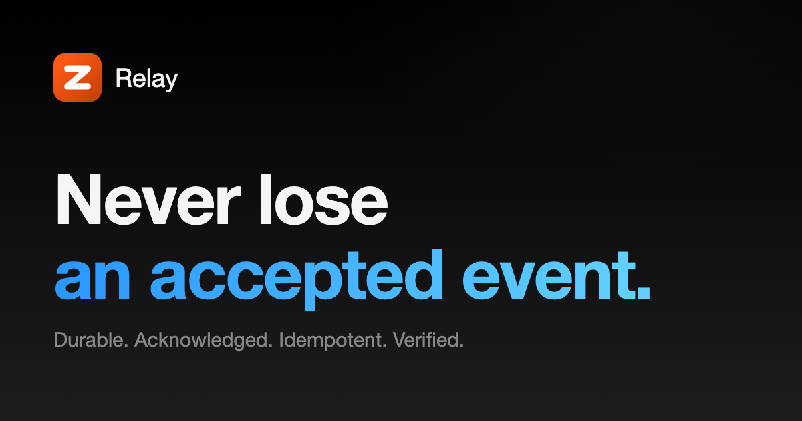

  

<h1 align="center">Zyvor Relay</h1>

<b>Never lose an accepted event.</b> 
Durable events. Acknowledged notifications. Idempotent actions. Verified outcomes.

  <a href="https://zyvorai.github.io/relay-site/"><b>Explore the live demo ›</b></a> &nbsp;·&nbsp;
  <a href="https://zyvorai.github.io/relay-site/changelog.html">What’s new ›</a>

  

## Four guarantees

| | Guarantee | What it means |
|---|---|---|
| 01 | **Durable** | Accepted events are persisted before acknowledgement and survive restarts. |
| 02 | **Acknowledged** | Notifications retry with backoff until confirmed. |
| 03 | **Idempotent** | Critical actions execute once, even when the network repeats itself. |
| 04 | **Verified** | Outcomes are checked against reality, not assumed from a 200 OK. |

## At a glance

- Single Go binary with an embedded operator console
- PostgreSQL storage, native TLS, OIDC with PKCE, multi-tenant
- Runs on a bare VM, k3s or Helm

## Open components

[github.com/zyvorai](https://github.com/zyvorai) hosts the adapters. Relay core is private; reach out to Zyvor AI Labs for access.

## Pricing

Per device per year, one ladder shared with Fleet, Device Agent, OTA and Nodra: 1-999 devices USD 18 (INR 1,784 incl. GST in India), 1,000-9,999 USD 12 (INR 1,189), 10,000 and above USD 8 (INR 793); annual minimum USD 5,000 (INR 495,600). Prices: INR incl. 18% GST in India; US dollars excl. tax elsewhere (VAT, GST or sales tax added where applicable). Pay online by UPI, card or netbanking where a buy page exists; international cards work (charged in rupees). Orders of USD 5,000 or more and quotes are invoiced in USD through Skydo. Custom pricing: contact [sales@zyvor.dev](mailto:sales@zyvor.dev). Production licences come with a 30-day trial key. Buy / get a quote: [zyvor.dev/buy](https://zyvor.dev/buy).

---
This repository contains the built website only. Licensed under the Zyvor Production Licence v2.0. © 2026 Zyvor AI Labs.
