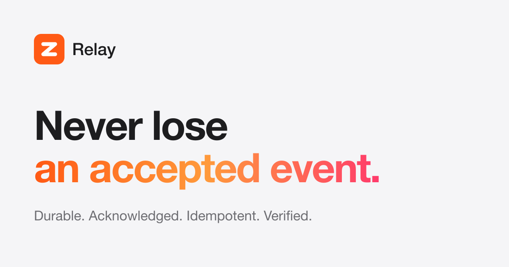

  

<h1 align="center">Zyvor Relay</h1>

<b>Never lose an accepted event.</b> 
Durable events. Acknowledged notifications. Idempotent actions. Verified outcomes.

  <a href="https://zyvorai.github.io/relay-site/"><b>Explore the live demo ›</b></a> &nbsp;·&nbsp;
  <a href="https://zyvorai.github.io/relay-site/changelog.html">What’s new ›</a>

  

## Four guarantees

| | Guarantee | What it means |
|---|---|---|
| 01 | **Durable** | Accepted events are persisted before acknowledgement and survive restarts. |
| 02 | **Acknowledged** | Notifications retry with backoff until confirmed. |
| 03 | **Idempotent** | Critical actions execute once, even when the network repeats itself. |
| 04 | **Verified** | Outcomes are checked against reality, not assumed from a 200 OK. |

## At a glance

- Single Go binary with an embedded operator console
- PostgreSQL storage, native TLS, OIDC with PKCE, multi-tenant
- Runs on a bare VM, k3s or Helm

## Open components

[github.com/zyvorai](https://github.com/zyvorai) hosts the open-source adapters. Relay core is private; reach out to Zyvor AI Labs for access.

---
This repository contains the built website only. Licensed under Apache-2.0. © 2026 Zyvor AI Labs.
